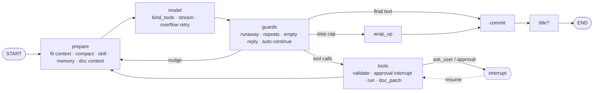

# Implementation Plan: Docu Builder GA

**Branch**: `001-docu-builder-ga` | **Date**: 2026-10-19 (rev. 3) | **Spec**: [spec.md](./spec.md)
**Input**: Feature specification from `/specs/001-docu-builder-ga/spec.md`
**Reference**: `~/Documents/myproject/my_agent` (agent_console). Its concepts are carried over through research.md Part A.

## Summary

Docu Builder is a hosted, multi-user AI agent that writes and edits structured documents (decks, documents, web pages, social posts) in Arabic and English.

**Agent design.** It follows agent_console:
- typed streaming events
- agent profiles
- skills
- memory
- MCP connectors
- human-in-the-loop questions and approvals
- context compaction
- loop guards

The loop is re-implemented on **LangChain + LangGraph**, and it runs in **Celery workers** instead of the API process. That removes agent_console's single-process limits.

**Applications.**
- A Python 3.12 package `docu` runs both the FastAPI API and the Celery workers.
- The React 19 frontend starts from agent_console's frontend (shell, composer, event blocks, choice forms, approval cards, i18n EN/AR) and adds the document editor: canvas, filmstrip, Patterns, and Present.

**Documents and exports.**
- Documents are structured slides stored as JSONB with revisions.
- Exports render the same slide component (PDF and PNG through Playwright) or native shapes (PPTX through `python-pptx`).
- Billing uses Stripe and a credit ledger.

## Technical Context

**Language/Version**: Backend: Python 3.12 (`uv`). Frontend: TypeScript 5.6 (strict), Node.js 22 LTS, pnpm 9.

**Primary Dependencies**:
- *Agent:* `langchain-core`, `langchain` (`init_chat_model`, `init_embeddings`), `langgraph`, `langgraph-checkpoint-postgres` (`AsyncPostgresSaver`, `AsyncPostgresStore`), `langchain-openai` (OpenAI-compatible upstream), `langchain-anthropic`, `langchain-mcp-adapters`, `langchain-community` and `langchain-text-splitters`, `langsmith`.
- *API and data:* FastAPI, Pydantic v2, pydantic-settings, SQLAlchemy 2 async with asyncpg and Alembic, pgvector, sse-starlette, Celery 5, redis-py.
- *Ported from agent_console:* `argon2-cffi`, `itsdangerous` (session tokens), `cryptography` (sealing connector secrets), `mcp`, `markitdown[pptx,docx,xlsx]`, `defusedxml`, `lxml`, Pillow, `ddgs`.
- *Added:* Authlib (Google OIDC), `pyotp` (TOTP), stripe, boto3, Playwright (Python), `python-pptx`, PyMuPDF, clamd, structlog, OpenTelemetry, sentry-sdk.
- *Frontend:* React 19, Vite, Tailwind 4, react-router 7, TanStack Query, i18next, Zustand (editor and turn store), `openapi-typescript` with `openapi-fetch`, `@sentry/react`.

**Storage**: PostgreSQL 16 with pgvector: app data, LangGraph checkpoints, the LangGraph Store (memories), and embeddings. Redis 7: Celery broker, turn event streams, leases, rate limits, MCP loaded-tools cache. `BlobStore` (local or S3, ported from agent_console).

**Testing**:
- pytest with agent_console's markers (`db`, `slow`, `e2e_*`), pytest-asyncio, testcontainers, Hypothesis, Schemathesis, respx.
- LangChain `GenericFakeChatModel` for graph tests.
- LangSmith `evaluate` for evals.
- Frontend: Vitest, Playwright (ar and en × desktop and mobile), axe-core.
- k6 for load tests.

**Target Platform**: Evergreen desktop and mobile browsers. Two deploy paths:
- A single-host Docker image (agent_console style, with the SPA baked in) plus worker and beat containers.
- AWS ECS Fargate.

**Project Type**: Web application, with `backend/` and `frontend/` in one repo.

**Performance Goals**:
- Time to first slide p95 under 8 s. Full draft p95 under 45 s.
- Time to the first SSE byte under 1 s (compaction runs after the stream opens, as in agent_console).
- Manual save p95 under 300 ms. Export p95 under 20 s.
- 500 concurrent turns.

**Constraints**:
- App JS under 250 KB gzip. Viewer JS under 120 KB.
- At most one active turn per document.
- Paused turns expire after 30 min.
- 25 MB per attachment.
- WCAG 2.2 AA. Arabic/English parity.
- `mypy --strict` and `ruff` stay clean.

**Scale/Scope**:
- 50k users and 5k daily actives in year one.
- 5 agent profiles, about 20 tools, about 15 built-in skills, 16+ themes, 24 templates, 7 layouts.

## Constitution Check

*GATE: Must pass before Phase 0 research. Re-checked after Phase 1 design.* (Constitution v1.2.0)

| Principle | Status | How the plan satisfies it |
|---|---|---|
| I. Typed tools | ✅ | The document changes only through the document tools in `docu/agent/tools/document.py`. Other tools (memory, skills, web, MCP) never touch the document. |
| II. Arabic/English parity | ✅ | agent_console i18n base, the `replying-bilingually` skill, Arabic-aware splitter, RTL in PDF and PPTX, e2e and evals in both languages |
| III. One schema | ✅ | Pydantic → OpenAPI → generated TypeScript. The event union is shared with the agent_console components. |
| IV. Reversible turns | ✅ | Draft and commit. Undo and rewind restore revisions. Interrupts don't commit. |
| V. Test-first | ✅ | Reducers, guards, interrupt/resume, permissions, ledger, webhooks |
| VI. Tenant isolation | ✅ | RLS, scoped sessions, memory namespaces per user, connector secrets sealed |
| VII. Observable | ✅ | OTel + LangSmith. Each turn records model, prompt version, tokens, and cost. |
| VIII. Simplicity | ⚠️ | Two languages, a worker process, Redis Streams. See Complexity Tracking. |

## Project Structure

### Documentation (this feature)

```text
specs/001-docu-builder-ga/
├── spec.md · plan.md · research.md · data-model.md · quickstart.md
├── ux.md                    # UI spec: tokens, components, every screen, agent thread UI
├── IMPLEMENTER.md           # read first: conventions, LangGraph primer, Definition of Done
├── tasks.md                 # index: 242 tasks, each linked to its card
├── tasks/phase-NN-*.md      # one detailed card per task (files, steps, interfaces, acceptance, verify)
├── contracts/ (rest-api.md · sse-events.md · agent-tools.md)
└── checklists/requirements.md
```

### Source Code (repository root)

```text
backend/
├── pyproject.toml                 # uv project "docu"
├── alembic/versions/
├── prompts/                       # Markdown prompts (agent_console format): deck.md, document.md, webpage.md,
│                                  # social.md, import.md, assistant.md, date_context.md, context_compact.md,
│                                  # auto_title.md, skills_index.md, session_web_search_{on,off}.md, …
├── skills/                        # SKILL.md folders: deck-writing, report-writing, pitch-deck, lesson-deck,
│                                  # landing-page-writing, social-post-writing, replying-bilingually,
│                                  # writing-deliverables, planning-with-intention, research, memory,
│                                  # theme-factory (Apache-2.0), brand-guidelines (Apache-2.0), …
├── src/docu/
│   ├── core/                      # config (agent_console env names), logging, otel, security, ratelimit,
│   │                              # errors, mail, flags, prompts loader
│   ├── domain/                    # Pydantic: document.py, tools.py, events.py, errors.py, api/*.py
│   ├── db/                        # models/, session.py (scoped), repositories/ (ownership in signature)
│   ├── storage/blob_store.py      # ported: Protocol + Local/S3
│   ├── auth/                      # ported: passwords (argon2), sessions, csrf; + verify, reset, google, totp
│   ├── services/                  # documents, revisions, threads, turns, sharing, invitations, permissions,
│   │                              # audit, attachments, exports, seats, admin, usage
│   ├── billing/                   # plans, prices, ledger, stripe_webhooks
│   ├── mcp/                       # ported: registry, oauth_flow, secrets (seal), shrink, guards, progressive
│   ├── agent/
│   │   ├── profiles.py            # AgentProfile + deck/document/webpage/social/import/assistant
│   │   ├── models.py              # init_chat_model registry (OpenAI-compatible first), effort/thinking map
│   │   ├── state.py               # TurnState
│   │   ├── graph.py               # build_graph(profile) → compiled StateGraph
│   │   ├── nodes/                 # prepare.py, model.py, guards.py, tools.py, wrap_up.py, commit.py, title.py
│   │   ├── budget.py              # ported: token estimates, fit, clip payloads, completion budget, step budget
│   │   ├── compact.py             # ported: rolling summary
│   │   ├── guards.py              # ported: runaway cutoff, repeated failing calls, empty reply recovery
│   │   ├── approvals.py           # tool approval policy + interrupt payloads (approval cards)
│   │   ├── reducers.py            # pure document reducers
│   │   ├── skills.py              # catalog (files + DB), index line, read
│   │   ├── memory.py              # Store-backed memories + brand memory, prompt block
│   │   ├── context.py             # document/template/attachments context message
│   │   ├── emit.py                # stream chunks → contract events → Redis XADD
│   │   ├── tools/                 # document, ask_user, skills, memory, attachments, web, image, mcp
│   │   ├── loaders/               # markitdown + PyMuPDF + pptx outline loaders
│   │   ├── moderation.py, tracing.py
│   ├── api/
│   │   ├── app.py                 # factory; serves web/dist in single-host mode (as agent_console)
│   │   ├── deps.py, sse.py, share_page.py
│   │   └── routers/               # auth, me, workspaces, documents, revisions, threads, turns, messages,
│   │                              # attachments, assets, sharing, public, exports, templates, themes,
│   │                              # memory, skills, connectors, models, billing, webhooks, admin, search, health
│   └── worker/
│       ├── celery_app.py          # queues: turns, files, exports, default; beat
│       └── tasks/                 # turn, resume, turn_reaper, interrupt_expiry, scan, parse, embed, import,
│                                  # export_pdf, export_pptx, image, thumbnail, credits, reconcile,
│                                  # usage_alerts, retention, account
├── scripts/                       # seed.py, setup_langgraph.py, check_endpoint.py (ported)
└── tests/ (unit/, integration/, contract/)
frontend/
├── apps/web/src/                  # starts from agent_console frontend/src
│   ├── components/                # ported: AppShell, NavRail, LanguageToggle, ConfirmDialog, chat/{Composer,
│   │                              # Blocks, ChoiceForm, ChoicePrompt, ApprovalDiffCard, Markdown,
│   │                              # ModelEffortPicker, ComposerPlusMenu}
│   ├── lib/                       # ported: sse.ts, chatRunner.ts, notify.ts, markdown.ts; + api (generated types)
│   ├── hooks/                     # ported: useAuth, useConversations, useLocalSetting, useTheme
│   ├── pages/                     # ported: Login, Register, Memory, Skills, Connectors, Settings, Admin;
│   │                              # new: Create, Documents, Conversations, Templates, Editor, Share, Billing, Trash
│   ├── features/editor/           # new: Canvas, Filmstrip, InlineText, Patterns, Present, VersionHistory
│   └── i18n/                      # ported en.json / ar.json + new keys
├── packages/api-types/            # GENERATED
└── packages/slides/               # renderer: 7 layouts, SVG charts, themes
evals/ · infra/ (compose.yaml, docker/, terraform/) · .github/workflows/
```

**Structure Decision**: Start from agent_console's layering (config → api → services → repositories → clients/storage) and its frontend. Replace its `services/agent/*` loop with `docu/agent/` on LangGraph. Move background work to `docu/worker/`.

## Agent Design

### Graph (one compiled graph per profile, cached)



- **TurnState**: `messages` (`add_messages`), `summary`, `draft`, `base_version`, `changed_slide_ids`, `usage`, `steps_used`, `max_steps`, `effort`, `loop` (agent_console's `_LoopState` flags: `empty_retries`, `auto_continued`, `overflow_retries`, `max_tokens_cap`, `recent_tool_fps`), `approved_tools`, `skill`, `web_search`.
- **Context**: `TurnContext` (passed through the `context` schema at runtime) holds `user_id`, `workspace_id`, `document_id`, `thread_id`, `turn_id`, `profile`, `locale`, and `plan`. Tools read it, never the model.

### What each node does (and where it came from)

| Node | Behavior | agent_console origin |
|---|---|---|
| `prepare` | Builds the system prompt: the profile prompt, date, memory block, skill index, inlined skills, connector instructions, and session toggles. Adds the document, template, and attachment context. Compacts when the estimate crosses the threshold (emits `status`). Clips old tool payloads to fit. | `agent/prompt.py`, `budget.py`, `context_compact.py` |
| `model` | `registry.chat(profile, plan, effort).bind_tools(tools)` streams. On context overflow it clips harder and halves `max_tokens`, up to 2 times. | `stream.py`, the overflow branch in `service.py` |
| `guards` | Cuts runaway repetition. Retries empty replies at lower effort. Sends the "keep going" auto-continue nudge once. Checks the schema-only and prose-ask nudges. | `runaway.py`, `replies.py`, `repeats.py` |
| `tools` | Checks arguments and returns broken-JSON hints. Refuses a repeated identical failing call. Applies the approval policy, using `interrupt()` with an approval card. `ask_user` uses `interrupt()` with options or a form. Runs the tool. Document tools emit `doc_patch` through `get_stream_writer()`. Errors become tool messages. | `registry.py`, `tool_round.py`, `approvals.py`, `ask_user.py` |
| `wrap_up` | At the step cap, makes one final no-tools call that asks for a summary of what was done. | `replies.wrap_up` |
| `commit` | One transaction: revision (if the draft changed), messages, turn usage, credit settlement, and `prompt_version_id`. | new |
| `title` | Small model plus `auto_title.md` after the first committed turn | `auto_title.py` |

### Tool registry per profile

`build_tools(profile, ctx)` returns the LangChain tools the profile allows (contracts/agent-tools.md):
- document tools
- `ask_user`
- `read_skill`
- `remember` and `forget`
- `read_attachment` and `search_attachments`
- `web_search` and `fetch_url` (only when the toggle is on)
- `generate_image` (only on plans that include it)
- `list_mcp_tools` and `use_mcp_tools`, plus the MCP tools already loaded

As in agent_console, `trim_tools_for_context` drops the lowest-priority schemas when they don't fit.

### Interrupt and resume (approvals and questions)

1. The tools node calls `interrupt({"kind": "approval" | "ask_user", ...})`.
2. The worker sees the `__interrupt__` update and:
   - emits `tool_approval` or `ask_user`,
   - stores a `pending_inputs` row,
   - sets the turn to `waiting_input`,
   - keeps the document lease (with a TTL that matches the expiry),
   - ends the Celery task.
3. `POST /v1/turns/{id}/resume` validates the answer against the pending row and enqueues `resume`. That task calls `graph.astream(Command(resume=answer), config)` and keeps emitting events on the same stream.
4. The beat task `interrupt_expiry` cancels `waiting_input` turns older than 30 min and refunds their credits.

### Models

- `docu/agent/models.py` maps each `(profile, plan, effort)` to a chat model, and holds a small model and a fallback.
- The defaults come from env names that match agent_console: `UPSTREAM`, `UPSTREAM_API_KEY`, `MODEL`, `VISION_MODEL`, `CONTEXT_WINDOW`, `MAX_COMPLETION_TOKENS`, `ENABLE_THINKING`.
- Admin overrides in the DB win over env (FR-053).
- `scripts/check_endpoint.py` is ported to check tool calling on any new upstream.

## Phase 0: Research

All decisions are in [research.md](./research.md): Part A covers the concepts carried over, and Part B covers R1 to R26.

Open business decisions:

| Item | Spec reference |
|---|---|
| Plan prices | FR-034 |
| Data region | FR-037 |
| Retention period | FR-038 |

## Phase 1: Design and Contracts

- [data-model.md](./data-model.md)
- [contracts/rest-api.md](./contracts/rest-api.md)
- [contracts/sse-events.md](./contracts/sse-events.md): agent_console event names, plus document and turn events
- [contracts/agent-tools.md](./contracts/agent-tools.md)
- [quickstart.md](./quickstart.md)

## Complexity Tracking

| Violation | Why needed | Simpler alternative rejected because |
|---|---|---|
| Two languages | LangChain and LangGraph are Python-first, and agent_console is Python. The frontend is React. | Generated types prevent drift |
| Separate Celery worker | Removes agent_console's single-process limit. Turns survive deploys and disconnects. | agent_console's in-process `ChatJobBroker` can't scale out |
| Redis Streams for events | Resume with `Last-Event-ID` from any API instance | In-memory fan-out (agent_console) works only in one process |
| LangGraph interrupts for HITL | Paused turns survive restarts and resume on any worker | agent_console's in-memory `ApprovalBroker` futures are lost on restart |
| RLS on top of scoped repositories | A second line of defense for SC-007 | agent_console's ownership-in-signature repositories alone would let one missed filter leak data |
